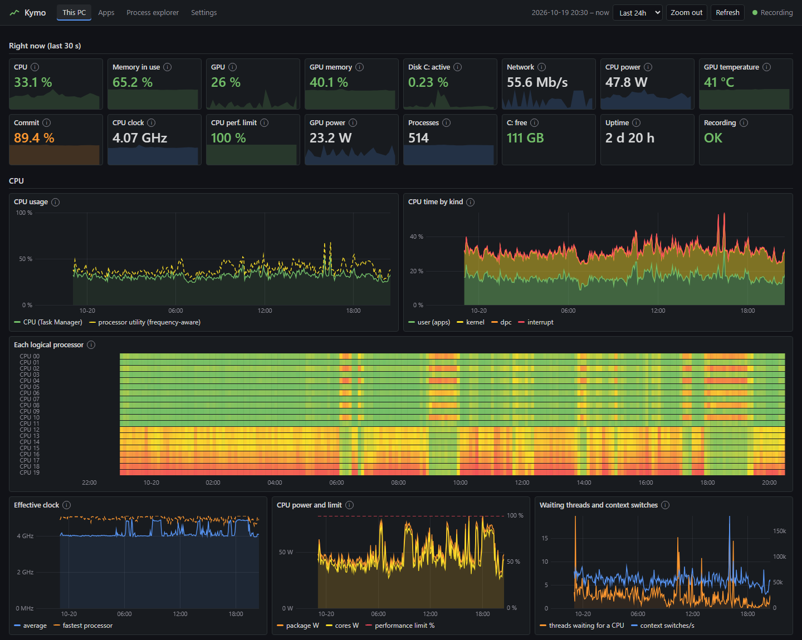
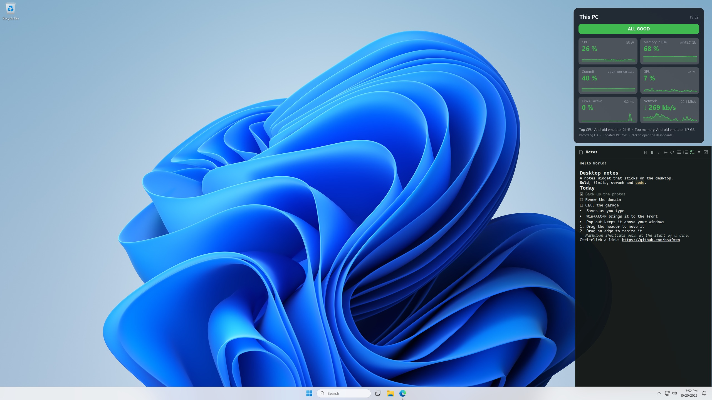
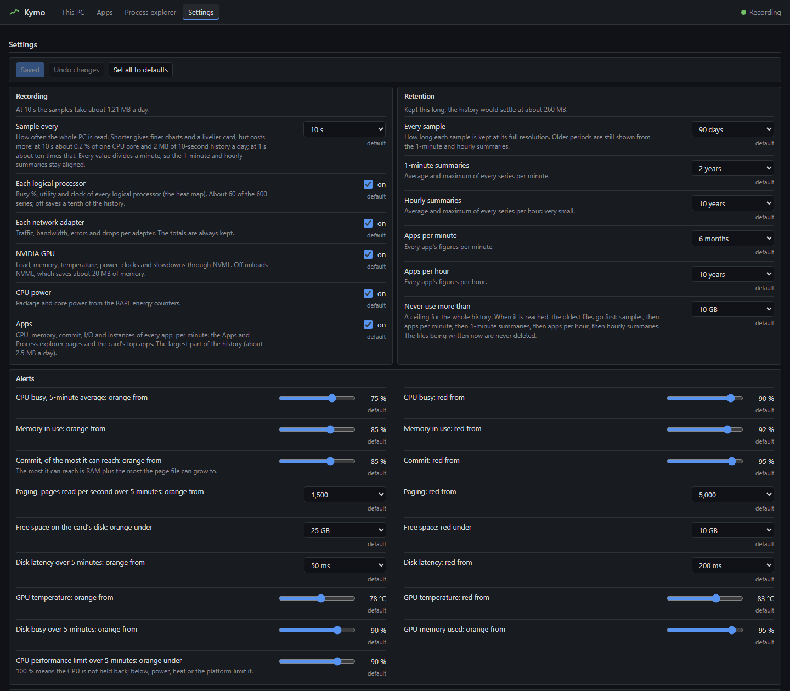

# Kymo

[](https://github.com/bsafwen/kymo/actions/workflows/ci.yml)
[](https://github.com/bsafwen/kymo/releases/latest)

See how your Windows PC performs, right now and over months and years. One small Rust program with no dependencies records the whole PC every 10 seconds into a compact history, serves dashboards on `http://127.0.0.1:21223` and feeds a live status card on the desktop, for about 0.2 % of one CPU core and 30 MB of memory.







## What you get

- **History of everything:** CPU (overall, per logical processor, clock, power, performance limit), memory, commit and paging, disks, network adapters, NVIDIA GPU, and every app per minute (CPU, memory, commit, I/O, instances).
- **Dashboards:** This PC, Apps, Process explorer and Settings. Pick a range or drag to zoom, from 15 minutes to 2 years.
- **Desktop card:** live figures, the last hour, top apps, and an alert line when something needs attention (CPU, memory, commit, disk, GPU heat). Drag it anywhere on the desktop, stretch it by an edge or scale it by a corner, set its transparency with Shift + scroll, and choose what it shows.
- **Process list:** every process on the desktop next to the card, like Task Manager's Processes tab: CPU, memory, I/O and GPU per app or per process, shaded by use, sorted by a click on a column title, read every 2 s while it can be seen.
- **Settings in the browser:** sample interval (1 s to 1 min), what to record, retention per tier, a size ceiling, alert thresholds, what the desktop card and the process list show, clearing history. Only valid values can be chosen.
- **Always on:** a Windows service that starts at boot, restarts after a crash or a hang, and listens on 127.0.0.1 only.

## Install

Needs Windows 10 or 11 and [PowerShell 7](https://aka.ms/powershell).

**From a release** (no Rust needed): download `kymo-<version>-windows-x64.zip` from the [latest release](https://github.com/bsafwen/kymo/releases/latest) and extract it to a folder you keep, for example `%LOCALAPPDATA%\Programs` (the desktop card and its sign-in tasks run from it, and `uninstall.ps1` is there). Then, in its `kymo-<version>-windows-x64` folder (the one with `install.ps1`):

```powershell
Get-ChildItem -Recurse | Unblock-File
pwsh -File .\install.ps1
```

**From the source**, with [Rust](https://rustup.rs) 1.81 or later (and the Visual Studio Build Tools):

```powershell
git clone https://github.com/bsafwen/kymo.git
cd kymo
pwsh -File .\install.ps1
```

Run it as yourself, not elevated: it uses the release's program or builds and tests one, asks once for administrator rights, installs the service, then sets up the desktop card and opens the dashboards at sign-in. Re-running it (or a newer release's) updates in place and keeps the history; it also takes over an install from when the program was called PerfHistory.

- Health report: `pwsh -File .\verify.ps1` (no admin rights).
- Remove: `pwsh -File .\uninstall.ps1` (elevated); add `-DeleteHistory` to delete the history too.

## Documentation

- [docs/GUIDE.md](docs/GUIDE.md): using it, the card's alerts, settings, where files are.
- [recorder/README.md](recorder/README.md): every series recorded, the HTTP API, the storage format, measured cost.

## Tests and releases

- **CI** ([.github/workflows/ci.yml](.github/workflows/ci.yml)), on every push and pull request, on Windows:
  - the recorder with Rust 1.81 and the latest stable: `cargo fmt --check`, `cargo clippy -- -D warnings`, the tests and a release build;
  - the desktop card: built with the C# compiler that ships with Windows, then its self-test (moving, resizing, settings, drawing);
  - every PowerShell script parses, the dashboards' script, the import script.
- **Releases** ([.github/workflows/release.yml](.github/workflows/release.yml)): set `version` in `recorder/Cargo.toml`, commit (with `Cargo.lock`), then tag and push:

  ```powershell
  git tag v0.2.0
  git push origin v0.2.0
  ```

  CI runs on the tag, then the release `kymo-<version>-windows-x64.zip` (the repository plus the tested `bin\kymo.exe`) is published with its `SHA256SUMS.txt` and the changes since the previous tag. Running the Release workflow by hand is a dry run: it keeps the files in the run and publishes nothing.

## License

Public domain: [The Unlicense](LICENSE). The desktop screenshot shows the default Windows 11 wallpaper, taskbar and icons, which belong to Microsoft and are not covered by this license.
